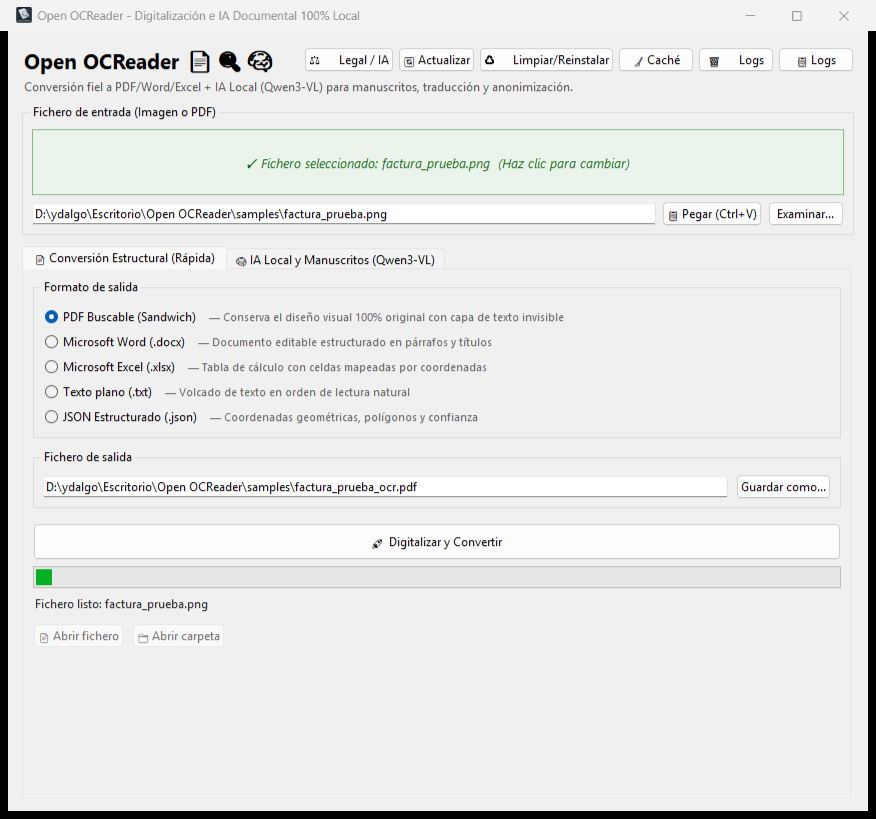
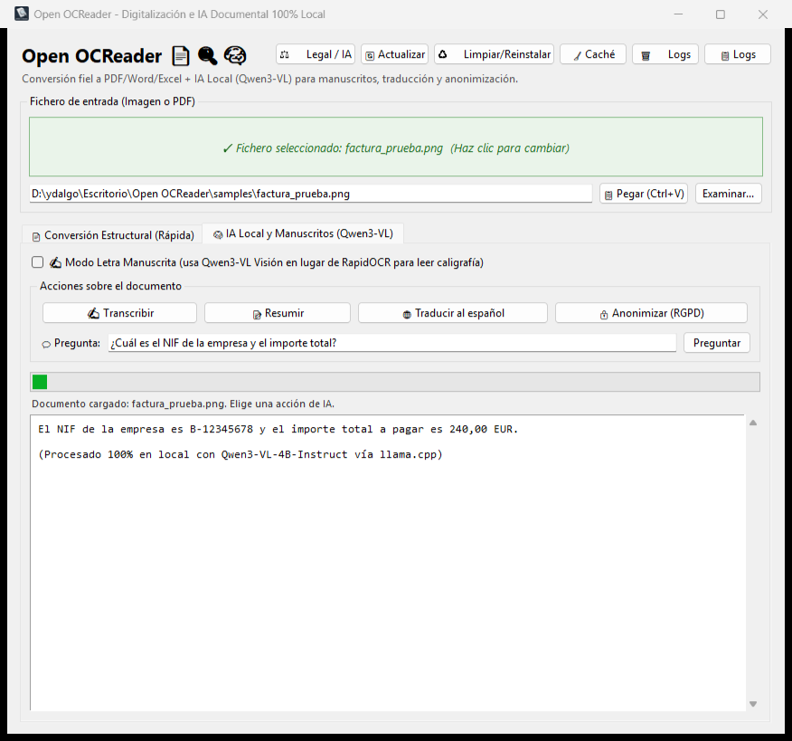

<p align="center">
  
</p>

<h1 align="center">Open OCReader 📄🔍🧠</h1>

<p align="center">
  <a href="https://www.gnu.org/licenses/gpl-3.0.html"></a>
  
  
  
  <a href="docs/CUMPLIMIENTO_IA_Y_LICENCIA.md"></a>
  <a href="SECURITY.md"></a>
</p>

**Open OCReader** es una suite de código abierto, ligera, **100% local (offline)** y endurecida para la digitalización fiel de documentos, el reconocimiento de **letra manuscrita** y el análisis documental mediante Inteligencia Artificial.

> 🛡️ **Arquitectura e Ingeniería compartida con el Proyecto Hermano [GuarIdA](https://github.com/Ydalgo/GuarIdA)**:
> El motor de contexto sin límite de páginas (**Árbol de Nodos Documental AST**, **Compresión BPE**, **Búsqueda Híbrida RRF BM25 + BGE-M3**, **Persistencia Segregada SQLite WAL comprimida por SHA-256**, **Reutilización de KV Cache** y **Observación Dinámica de Hardware**) proviene de las investigaciones, ADRs y código del proyecto **[GuarIdA](https://github.com/Ydalgo/GuarIdA)** (*Guardián de Identidad y Asistencia con IA Local Soberana*, actualmente en desarrollo activo). ¡Te invitamos a visitarlo, darle una ⭐ y seguir su evolución!

---

## 🖼️ Capturas de Pantalla

| Conversión Estructural Rápida (PDF Sandwich, Word, Excel) | IA Local y Manuscritos (`Qwen3-VL-4B` vía `llama.cpp`) |
| :---: | :---: |
|  |  |

---

## 📁 Estructura del Proyecto

```text
Open OCReader/
├── src/                      # Código fuente en Python
│   ├── ocr_tool.py           # CLI principal (consola y lanzador GUI)
│   ├── ocr_server.py         # Modo Servidor API REST (FastAPI + Uvicorn)
│   ├── Open_OCReader.pyw     # Lanzador gráfico sin consola (Windows)
│   └── open_ocreader/        # Núcleo modular (OCR, formatos, GUI, IA, API, seguridad, logs)
├── scripts/
│   ├── windows/              # Compilador Nuitka/PyInstaller y lanzadores .bat (GUI y Servidor)
│   └── linux/                # Scripts .sh de instalación, compilación y servicio systemd
├── ico/                      # Icono oficial (.ico y .png) para ventana y ejecutable
├── models/                   # Modelos GGUF locales (Qwen3-VL-4B-Instruct + mmproj)
├── bin/                      # Binarios portables de llama.cpp (GPU Vulkan / Metal / CPU)
├── dist/                     # Ejecutables independientes compilados (.exe / binario Linux)
├── samples/                  # Documentos de muestra para pruebas
├── docs/                     # Guías de instalación, cumplimiento normativo y licencia
└── SECURITY.md               # Política y controles de ciberseguridad
```

---

## 🌟 Arquitectura en Tres Pilares

1. **Pilar 1: Digitalización y Conversión Universal (`RapidOCR` + Detección Inteligente PDF)**
   - **Detección página por página de PDFs ya buscables**: si un PDF ya contiene texto embebido, omite el OCR innecesario (extracción directa en milisegundos) con opción *"Forzar OCR"* si se desea re-escanear.
   - **10 formatos de salida**: **PDF Buscable (Sandwich)**, **PDF/A-2b** (estándar oficial de archivo para Administraciones Públicas), **Word (`.docx`) y OpenDocument (`.odt`) con recreación visual fiel** (conservando fondos, imágenes, colores y cuadros de texto editables), **Excel (`.xlsx`)**, **OpenDocument Calc (`.ods`)**, **CSV (`.csv`)**, **eBook EPUB 3 (`.epub`)**, **Texto (`.txt`)** y **JSON (`.json`)**.
   - **Compresión PDF y Escala de grises**: niveles *Alta calidad*, *Equilibrada* y *Máxima compresión* + conversión a blanco y negro.

2. **Pilar 2: Inteligencia Documental Local vinculada al Hardware (`llama.cpp` + `Qwen3-VL` + `BGE-M3`)**
   - **Perfiles automáticos según Hardware (`ultra_light` / `light` / `standard` / `pro`)**: mide la RAM real y la GPU (**Vulkan**, **Apple Metal** o **CPU**) para elegir automáticamente `Qwen3-VL-4B` o `Qwen3-VL-2B` (Apache 2.0), el contexto `n_ctx` seguro y activar `BGE-M3` (MIT, bajo demanda o residente) con protección anti-OOM.
   - **Árbol de Nodos AST + Búsqueda Híbrida RRF (`BGE-M3` + `BM25Okapi`) + Compresión BPE** *(inspirado en GuarIdA)*: poda el contexto de documentos largos (50–300+ páginas), recicla la **KV Cache** (`cache_prompt`) y guarda el índice en **SQLite WAL comprimido (`zstd`/`zlib`) por SHA-256**.
   - **✍️ OCR Manuscrito**, **🌐 Traducción a cualquier idioma**, **🔒 Anonimización RGPD híbrida**, **📝 Resúmenes ejecutivos Map-Reduce AST** y **💬 Preguntas (Q&A)**.

3. **Pilar 3: Herramientas PDF (`pikepdf` + `PyMuPDF` + `OpenCV`)**
   - **🔓 Desbloqueo de PDFs** (eliminación de restricciones de copia/impresión o desencriptación con contraseña autorizada; sin fuerza bruta).
   - **✍️ Borrado de firmas digitales** (campos `/Sig`, bloqueos `DocMDP` y sellos visuales).
   - **🧽 Limpieza de marcas de agua** (anotaciones `/Watermark`, capas OCG, texto específico y limpieza OpenCV en escaneos).
   - **🗜️ Optimización directa** (compresión, escala de grises y conversión a PDF/A-2b). Desactivable por política ENS con `OPEN_OCREADER_DISABLE_PDF_TOOLS=1`.

---

## ⚖️ Cumplimiento Normativo de IA y Privacidad (Empresas y Administración Pública)

**Open OCReader** ha sido diseñado bajo el principio de **privacidad y seguridad desde el diseño** para facilitar su despliegue legal en **Administraciones Públicas y empresas**:

* **🇪🇺 EU AI Act (Reglamento (UE) 2024/1689)**: Herramienta auxiliar documental de **riesgo mínimo/limitado** con separación transparente entre OCR determinista e IA generativa. Se requiere **supervisión humana (*Human-in-the-Loop*)** de toda salida generada por IA antes de su uso oficial o legal.
* **🇪🇺 RGPD y 🇪🇸 LOPDGDD**: Procesamiento **100% local (on-premise / offline)** sin transferencias internacionales de datos ni envío a servidores externos. Incluye anonimización asistida.
* **🇪🇸 Esquema Nacional de Seguridad (ENS)**: Apto para redes aisladas (*air-gapped*) con verificación criptográfica SHA-256, logs auditables y API autenticada.
* **🇺🇸 / 🌐 Estándares Internacionales (NIST AI RMF, HIPAA, CCPA/CPRA, ISO/IEC 42001)**: Arquitectura abierta, auditable y sin telemetría.

Consulta el detalle completo en **[docs/CUMPLIMIENTO_IA_Y_LICENCIA.md](docs/CUMPLIMIENTO_IA_Y_LICENCIA.md)** y la política de seguridad en **[SECURITY.md](SECURITY.md)**.

---

## 🖥️ Requisitos de Hardware (Independientes por Modo)

Como los dos pilares de **Open OCReader** funcionan de manera independiente, los requisitos dependen de si solo necesitas digitalización rápida o si además activas la IA local:

| Componente | Modo 1: Digitalización Rápida *(RapidOCR)* | Modo 2: IA Local y Manuscritos *(Qwen3-VL-4B)* |
| :--- | :--- | :--- |
| **Procesador (CPU)** | Cualquier x64 / ARM64 de 2 núcleos | Mínimo 4 núcleos / **Recomendado 8+ núcleos** |
| **Memoria RAM** | Mínimo **2 GB** / Recomendado 4 GB | Mínimo **8 GB** (~5 GB libres) / **Recomendado 16 GB** |
| **Tarjeta Gráfica (GPU)** | **No requerida** (100% CPU en ~1s/pág.) | Opcional (corre en CPU). **Recomendada GPU Vulkan** (NVIDIA/AMD/Intel ≥6 GB) o **Apple Metal** |
| **Espacio en Disco** | ~350 MB | **~4 GB adicionales** (`models/` ~2,9 GB + `bin/` ~30 MB) |
| **Conexión a Internet** | Solo para instalar | Solo en la primera descarga del modelo (luego **100% offline**) |

---

## 📥 Instalación y Uso según tu Sistema Operativo

### 🪟 Windows

* **Ejecutable independiente (sin Python instalado)**:
  - Compílalo con **Nuitka** (C nativo, ofuscado y con icono oficial) haciendo doble clic en **`scripts\windows\compilar.bat`** (o con `--target server` para compilar `Open_OCReader_Server.exe`).
  - Arranca la app visual con **`scripts\windows\iniciar.bat`** o el servidor API con **`scripts\windows\iniciar_servidor.bat`**.
* **Desde el código fuente**:
  ```powershell
  git clone https://github.com/Ydalgo/Open-OCReader.git
  cd Open-OCReader
  pip install -r requirements.txt
  pythonw src\Open_OCReader.pyw
  ```

### 🐧 Linux

```bash
git clone https://github.com/Ydalgo/Open-OCReader.git
cd Open-OCReader
chmod +x scripts/linux/*.sh
./scripts/linux/instalar.sh
./scripts/linux/iniciar.sh
```
* **Compilar binario independiente**: `./scripts/linux/compilar.sh`
* **Instalar como servicio `systemd`**: `./scripts/linux/instalar_servicio.sh`

---

## 🌐 Modo Servidor API REST (para clientes web)

> 📖 Consulta la guía completa paso a paso de puesta en marcha, puertos configurables, TLS 1.3 y variables SIEM en **[docs/GUIA_DESPLIEGUE_SERVIDOR.md](docs/GUIA_DESPLIEGUE_SERVIDOR.md)**.

```bash
# Arrancar servidor en localhost (Swagger UI en http://127.0.0.1:8000/docs)
python src/ocr_server.py --host 127.0.0.1 --port 8000

# Arrancar en red local (autogenera clave X-API-Key si no se define OPEN_OCREADER_API_KEY)
python src/ocr_server.py --host 0.0.0.0 --port 8000
```

---

## 💻 Uso desde Terminal (CLI)

```bash
# Abrir interfaz gráfica (Drag & Drop, Ctrl+V, sin consola CMD)
python src/ocr_tool.py

# Conversión estructural (PDF Sandwich, Excel, Word, TXT, JSON)
python src/ocr_tool.py samples/factura_prueba.png
python src/ocr_tool.py samples/factura_prueba.png -f xlsx

# Inteligencia Artificial local
python src/ocr_tool.py carta_manuscrita.jpg -m
python src/ocr_tool.py contrato.pdf --ai summarize
python src/ocr_tool.py manual_en.pdf --ai translate
python src/ocr_tool.py nomina.pdf --ai anonymize
python src/ocr_tool.py factura.png --ai ask --question "¿Cuál es el total?"

# Mantenimiento y actualizaciones sin desinstalar
python src/ocr_tool.py --clear-cache
python src/ocr_tool.py --clear-logs
python src/ocr_tool.py --check-update
python src/ocr_tool.py --update
```

---

## 🛠️ Tecnologías Utilizadas, Créditos y Agradecimiento Personal

> **Agradecimiento de Ydalgo:**
> *Este proyecto no habría sido posible sin el trabajo generoso y brillante de miles de desarrolladores, investigadores y comunidades de software libre de todo el mundo. Quiero expresar mi más sincero agradecimiento personal a todos los autores, mantenedores y organizaciones detrás de cada una de estas tecnologías por compartirlas abiertamente y permitirnos construir herramientas libres, privadas y al alcance de cualquiera.*

### 🐍 Lenguajes y Sistemas Operativos
* **[Python](https://www.python.org/)**: Lenguaje principal que orquesta toda la aplicación (núcleo OCR, interfaz gráfica con `Tkinter`, CLI, API REST, mantenimiento y gobernanza). Elegido por su claridad, ecosistema científico y portabilidad multiplataforma.
* **C / C++**: Lenguaje en el que están escritos los motores de alto rendimiento subyacentes (`llama.cpp`, `ONNX Runtime`, `OpenCV`, `PDFium`) y al que **Nuitka** compila la aplicación para distribuir ejecutables nativos rápidos y autónomos.
* **Batch / PowerShell y Bash / `systemd`**: Scripts nativos de automatización, instalación, compilación y servicios del sistema.
* **Sistemas Operativos soportados**: **Windows**, **GNU/Linux** y **macOS**, con detección automática de aceleración gráfica mediante **[Vulkan](https://www.vulkan.org/)**, **Apple Metal** o **CPU**.

### 🔍 Motor de Digitalización Estructural
* **[RapidOCR](https://github.com/RapidAI/RapidOCR) y [ONNX Runtime](https://onnxruntime.ai/)**:
  * **RapidOCR** es un motor OCR de código abierto derivado de PaddleOCR, diseñado para extraer texto con coordenadas geométricas exactas a gran velocidad en CPU sin dependencias pesadas.
  * **ONNX Runtime** (Microsoft) es el motor de inferencia multiplataforma en C++ que ejecuta los modelos neuronales de RapidOCR con optimizaciones de procesador (AVX2/SIMD).
* **Procesamiento Documental, PDF Avanzado e Imagen**:
  * **[pypdfium2](https://github.com/pypdfium2-team/pypdfium2)** (Google PDFium), **[pypdf](https://pypdf.readthedocs.io/)**, **[pikepdf](https://pikepdf.readthedocs.io/)** (basado en **[QPDF](https://qpdf.sourceforge.io/)** — MPL-2.0) y **[PyMuPDF](https://pymupdf.readthedocs.io/)** (Artifex — AGPL-3.0) para lectura rápida sin OCR, PDF/A-2b, desbloqueo, firmas y marcas de agua.
  * **[pdf2docx](https://github.com/ArtifexSoftware/pdf2docx)**, **[python-docx](https://python-docx.readthedocs.io/)** y **[openpyxl](https://openpyxl.readthedocs.io/)** para generación fiel de Word, ODT, Excel, ODS, CSV y EPUB 3.
  * **[ReportLab](https://www.reportlab.com/)**, **[OpenCV](https://opencv.org/)**, **[Pillow](https://python-pillow.org/)** y **[psutil](https://github.com/giampaolo/psutil)** para PDF Sandwich, *inpainting* de fondos, escala de grises y telemetría de hardware.

### 🧠 Motor de Inteligencia Artificial Local
* **[llama.cpp](https://github.com/ggml-org/llama.cpp)**: Extraordinario motor de inferencia en C/C++ impulsado por Georgi Gerganov y la comunidad `ggml-org`. Ejecuta tanto los modelos VLM como el servidor de embeddings en formato **GGUF** 100% en local sobre CPU, Vulkan, CUDA y Metal.
* **[Qwen3-VL-4B-Instruct](https://huggingface.co/Qwen/Qwen3-VL-4B-Instruct-GGUF) y [Qwen3-VL-2B-Instruct](https://huggingface.co/Qwen/Qwen3-VL-2B-Instruct-GGUF)** ([Qwen Team — Alibaba](https://qwenlm.github.io/), licencia **Apache 2.0**): Familia multimodal (Visión + Lenguaje) escalada automáticamente según la RAM del equipo para manuscritos, traducción, resúmenes, Q&A y anonimización RGPD.
* **[BGE-M3](https://huggingface.co/gpustack/bge-m3-GGUF)** ([BAAI — Beijing Academy of Artificial Intelligence](https://github.com/FlagOpen/FlagEmbedding), licencia **MIT**): Modelo multilingüe de embeddings de última generación utilizado para la búsqueda híbrida (Vectorial + BM25 RRF) sobre el Árbol de Nodos AST.
* **[Hugging Face](https://huggingface.co/)**: Plataforma abierta que aloja y distribuye los modelos oficiales GGUF con verificación criptográfica SHA-256.

### 🛡️ Reconocimiento Especial y Proyecto Hermano: GuarIdA

Un pilar fundamental de la arquitectura y la ingeniería de contexto de **Open OCReader** proviene directamente de las investigaciones, diseños y código desarrollados en el proyecto hermano **[GuarIdA](https://github.com/Ydalgo/GuarIdA)** (*Guardián de Identidad y Asistencia Documental con IA Local Soberana*):

* **Repositorio oficial**: **[https://github.com/Ydalgo/GuarIdA](https://github.com/Ydalgo/GuarIdA)**
* **Componentes estructurales y algoritmos transferidos desde GuarIdA**:
  1. **Árbol de Nodos Documental (AST)** (`doc_tree.py`): Descomposición jerárquica y semántica de documentos extensos (secciones, títulos, tablas y bloques OCR) con asignación de rutas de contexto, eliminando el límite de ventana de contexto del LLM.
  2. **Compresión de Vocabulario BPE y Minificación** (`chunking.py`, `doc_tree.py`): Algoritmos de condensación sintáctica para maximizar la densidad informativa por token en modelos de lenguaje pequeños (SLM) y medianos.
  3. **Recuperación Híbrida RRF (Reciprocal Rank Fusion)** (`doc_tree.py`, `multi_doc_chat.py`): Fusión calibrada de ranking léxico (`BM25Okapi`) con similitud vectorial densa (`BGE-M3`) para búsqueda precisa sin alucinaciones.
  4. **Caché Persistente en SQLite WAL con Compresión** (`doc_cache.py`): Indexación única por huella criptográfica SHA-256 del fichero, persistida en SQLite en modo WAL con compresión `zstd`/`zlib`, permitiendo reapertura instantánea de sesiones y proyectos sin reindexar.
  5. **Telemetría y Observación Dinámica de Hardware** (`hardware.py`): Diagnóstico en tiempo real de RAM, VRAM y aceleración gráfica (Vulkan/Metal/CPU) con asignación dinámica de perfiles (`ultra_light`, `light`, `standard`, `pro`) y salvaguardas contra OOM.
  6. **Reutilización de KV Cache (`cache_prompt`)**: Optimización del tiempo a primer token (TTFT) en diálogos multivuelta.

> 🌟 **¿Te interesa la Inteligencia Artificial Local, Soberana y Privada?**
> Te invitamos cordialmente a conocer, dar una estrella ⭐ y seguir el desarrollo de **[GuarIdA](https://github.com/Ydalgo/GuarIdA)**. El proyecto se encuentra actualmente en desarrollo activo y ampliará sustancialmente las capacidades de asistencia soberana, análisis de identidad y privacidad documental.

### 🌐 Servidor API, Compilación Nativa y Seguridad Continua
* **[FastAPI](https://fastapi.tiangolo.com/)**, **[Uvicorn](https://www.uvicorn.org/)** y **[Nginx](https://nginx.org/)**: Base del modo servidor REST endurecido, documentación interactiva Swagger UI y despliegue con cifrado **TLS 1.3**.
* **[Nuitka](https://nuitka.net/)** y **[PyInstaller](https://pyinstaller.org/)**: Herramientas de compilación que permiten empaquetar Open OCReader en ejecutables independientes para ordenadores sin Python instalado.
* **[GitHub Dependabot](https://github.com/dependabot)**: Nuestro agradecimiento especial al bot oficial de mantenimiento y seguridad de GitHub por auditar continuamente la cadena de suministro (`requirements.txt` y `requirements.lock.txt`), alertar sobre vulnerabilidades (CVEs) y proponer actualizaciones automáticas verificadas para mantener Open OCReader siempre seguro.

---

## 📄 Licencia Libre (Copyleft) y Autoría

**Open OCReader** es **Software Libre** distribuido bajo la licencia **[GNU General Public License v3.0 (GNU GPL v3.0)](https://www.gnu.org/licenses/gpl-3.0.html)**:

* **Libertad de uso**: Libre para uso personal, corporativo y en la Administración Pública.
* **Mención obligatoria**: Cualquier reproducción, distribución o trabajo derivado debe mantener el reconocimiento expreso a los autores originales.
* **Copyleft fuerte (Compartir Igual)**: Si reproduces, modificas o distribuyes una versión basada en Open OCReader, **estás obligado a publicar tu versión derivada también como código libre bajo la misma licencia GNU GPL v3.0**. No se permite cerrar el código en un producto privativo.
* **Exención de Responsabilidad sobre la IA e Integridad de Pesos**: Open OCReader integra modelos abiertos de terceros (`Qwen3-VL` y `BGE-M3`). El creador y colaboradores **NO alteran, entrenan ni modifican los pesos neuronales originales** (se ejecutan en sus versiones oficiales GGUF con verificación criptográfica SHA-256). Los autores no asumen responsabilidad alguna por las respuestas, redacciones o expresiones que pueda formular el modelo de IA. Conforme al EU AI Act, el usuario final debe revisar y validar humanamente (*Human-in-the-Loop*) toda salida antes de su uso oficial.

* **Autores**:
  * **[Ydalgo](https://github.com/Ydalgo)** — Creador y mantenedor del proyecto
  * **[Antigravity](https://deepmind.google/)** (Google DeepMind) — Asistente de arquitectura, seguridad y desarrollo
  * **[GitHub Dependabot (`dependabot[bot]`)](https://github.com/dependabot)** — Vigilancia automatizada de vulnerabilidades y mantenimiento continuo de dependencias seguras (`pip`)

* **Documentación y Colaboración**:
  * Guía de instalación: [docs/INSTALACION_Y_USO.md](docs/INSTALACION_Y_USO.md)
  * Despliegue de servidor API: [docs/GUIA_DESPLIEGUE_SERVIDOR.md](docs/GUIA_DESPLIEGUE_SERVIDOR.md)
  * Preguntas Frecuentes (FAQ): [docs/FAQ.md](docs/FAQ.md)
  * Cumplimiento IA y Licencia: [docs/CUMPLIMIENTO_IA_Y_LICENCIA.md](docs/CUMPLIMIENTO_IA_Y_LICENCIA.md)
  * Seguridad: [SECURITY.md](SECURITY.md) | Historial de cambios: [CHANGELOG.md](CHANGELOG.md)
  * ¿Quieres colaborar o reportar un fallo? Abre un [Issue](https://github.com/Ydalgo/Open-OCReader/issues) o una [Pull Request](https://github.com/Ydalgo/Open-OCReader/pulls).
