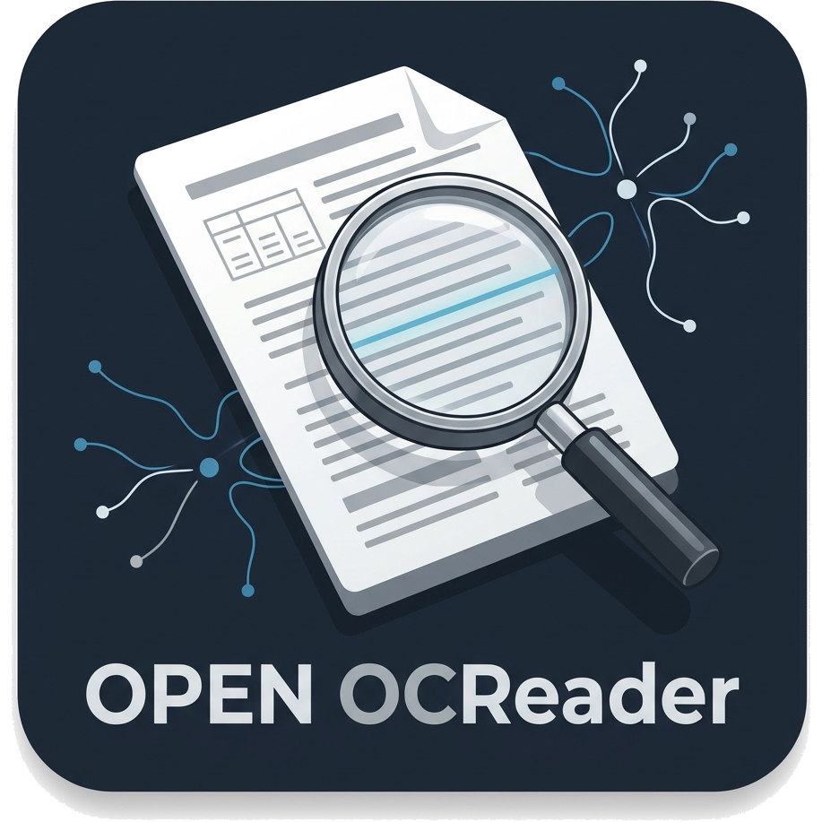

<p align="center">
  
</p>

<h1 align="center">Open OCReader 📄🔍🧠</h1>

<p align="center">
  <a href="https://www.gnu.org/licenses/gpl-3.0.html"></a>
  
  
  
  <a href="docs/CUMPLIMIENTO_IA_Y_LICENCIA.md"></a>
  <a href="SECURITY.md"></a>
</p>

**Open OCReader** es una suite de código abierto, ligera, **100% local (offline)** y endurecida para la digitalización fiel de documentos, el reconocimiento de **letra manuscrita** y el análisis documental mediante Inteligencia Artificial.

---

## 📁 Estructura del Proyecto

```text
Open OCReader/
├── src/                      # Código fuente en Python
│   ├── ocr_tool.py           # CLI principal (consola y lanzador GUI)
│   ├── ocr_server.py         # Modo Servidor API REST (FastAPI + Uvicorn)
│   ├── Open_OCReader.pyw     # Lanzador gráfico sin consola (Windows)
│   └── open_ocreader/        # Núcleo modular (OCR, formatos, GUI, IA, API, seguridad, logs)
├── scripts/
│   ├── windows/              # Compilador Nuitka/PyInstaller y lanzadores .bat (GUI y Servidor)
│   └── linux/                # Scripts .sh de instalación, compilación y servicio systemd
├── ico/                      # Icono oficial (.ico y .png) para ventana y ejecutable
├── models/                   # Modelos GGUF locales (Qwen3-VL-4B-Instruct + mmproj)
├── bin/                      # Binarios portables de llama.cpp (GPU Vulkan / Metal / CPU)
├── dist/                     # Ejecutables independientes compilados (.exe / binario Linux)
├── samples/                  # Documentos de muestra para pruebas
├── docs/                     # Guías de instalación, cumplimiento normativo y licencia
└── SECURITY.md               # Política y controles de ciberseguridad
```

---

## 🌟 Arquitectura en Dos Pilares

1. **Pilar 1: Digitalización Estructural Rápida (`RapidOCR / ONNX`)**
   - Extrae el 100% del texto de imágenes (`JPG`, `PNG`, `TIFF`, `BMP`, `WebP`) y `PDF` multipágina.
   - **PDF Buscable (Sandwich)**: Mantiene la imagen original intacta al 100% con una capa de texto invisible alineada por coordenadas.
   - Exportación a **Word (`.docx`)**, **Excel (`.xlsx` con protección contra inyección de fórmulas)**, **Texto (`.txt`)** y **JSON (`.json`)**.

2. **Pilar 2: Inteligencia Documental Local (`llama.cpp` + `Qwen3-VL-4B-Instruct`)**
   - **Detección automática de hardware**: Selecciona el binario óptimo (**GPU Vulkan**, **Apple Metal** o **CPU**) con respaldo automático a CPU si falla la GPU.
   - **Modelo residente en memoria**: Se carga una sola vez y permanece activo durante toda la sesión para responder al instante.
   - **✍️ OCR sobre Letra Manuscrita**: Lee caligrafía humana difícil mediante visión multimodal.
   - **🌐 Traducción al Español**: Traduce documentos de cualquier idioma manteniendo términos técnicos.
   - **🔒 Anonimización RGPD**: Ocultación híbrida (Regex determinista + IA) de DNI, NIE, CIF, IBAN, teléfonos, correos, nombres y direcciones.
   - **💬 Preguntas y Resúmenes (Q&A)**: Haz preguntas directas sobre el contenido o genera resúmenes ejecutivos.

---

## ⚖️ Cumplimiento Normativo de IA y Privacidad (Empresas y Administración Pública)

**Open OCReader** ha sido diseñado bajo el principio de **privacidad y seguridad desde el diseño** para facilitar su despliegue legal en **Administraciones Públicas y empresas**:

* **🇪🇺 EU AI Act (Reglamento (UE) 2024/1689)**: Herramienta auxiliar documental de **riesgo mínimo/limitado** con separación transparente entre OCR determinista e IA generativa. Se requiere **supervisión humana (*Human-in-the-Loop*)** de toda salida generada por IA antes de su uso oficial o legal.
* **🇪🇺 RGPD y 🇪🇸 LOPDGDD**: Procesamiento **100% local (on-premise / offline)** sin transferencias internacionales de datos ni envío a servidores externos. Incluye anonimización asistida.
* **🇪🇸 Esquema Nacional de Seguridad (ENS)**: Apto para redes aisladas (*air-gapped*) con verificación criptográfica SHA-256, logs auditables y API autenticada.
* **🇺🇸 / 🌐 Estándares Internacionales (NIST AI RMF, HIPAA, CCPA/CPRA, ISO/IEC 42001)**: Arquitectura abierta, auditable y sin telemetría.

Consulta el detalle completo en **[docs/CUMPLIMIENTO_IA_Y_LICENCIA.md](docs/CUMPLIMIENTO_IA_Y_LICENCIA.md)** y la política de seguridad en **[SECURITY.md](SECURITY.md)**.

---

## 🖥️ Requisitos de Hardware (Independientes por Modo)

Como los dos pilares de **Open OCReader** funcionan de manera independiente, los requisitos dependen de si solo necesitas digitalización rápida o si además activas la IA local:

| Componente | Modo 1: Digitalización Rápida *(RapidOCR)* | Modo 2: IA Local y Manuscritos *(Qwen3-VL-4B)* |
| :--- | :--- | :--- |
| **Procesador (CPU)** | Cualquier x64 / ARM64 de 2 núcleos | Mínimo 4 núcleos / **Recomendado 8+ núcleos** |
| **Memoria RAM** | Mínimo **2 GB** / Recomendado 4 GB | Mínimo **8 GB** (~5 GB libres) / **Recomendado 16 GB** |
| **Tarjeta Gráfica (GPU)** | **No requerida** (100% CPU en ~1s/pág.) | Opcional (corre en CPU). **Recomendada GPU Vulkan** (NVIDIA/AMD/Intel ≥6 GB) o **Apple Metal** |
| **Espacio en Disco** | ~350 MB | **~4 GB adicionales** (`models/` ~2,9 GB + `bin/` ~30 MB) |
| **Conexión a Internet** | Solo para instalar | Solo en la primera descarga del modelo (luego **100% offline**) |

---

## 📥 Instalación y Uso según tu Sistema Operativo

### 🪟 Windows

* **Ejecutable independiente (sin Python instalado)**:
  - Compílalo con **Nuitka** (C nativo, ofuscado y con icono oficial) haciendo doble clic en **`scripts\windows\compilar.bat`** (o con `--target server` para compilar `Open_OCReader_Server.exe`).
  - Arranca la app visual con **`scripts\windows\iniciar.bat`** o el servidor API con **`scripts\windows\iniciar_servidor.bat`**.
* **Desde el código fuente**:
  ```powershell
  git clone https://github.com/Ydalgo/Open-OCReader.git
  cd Open-OCReader
  pip install -r requirements.txt
  pythonw src\Open_OCReader.pyw
  ```

### 🐧 Linux

```bash
git clone https://github.com/Ydalgo/Open-OCReader.git
cd Open-OCReader
chmod +x scripts/linux/*.sh
./scripts/linux/instalar.sh
./scripts/linux/iniciar.sh
```
* **Compilar binario independiente**: `./scripts/linux/compilar.sh`
* **Instalar como servicio `systemd`**: `./scripts/linux/instalar_servicio.sh`

---

## 🌐 Modo Servidor API REST (para clientes web)

> 📖 Consulta la guía completa paso a paso de puesta en marcha, puertos configurables, TLS 1.3 y variables SIEM en **[docs/GUIA_DESPLIEGUE_SERVIDOR.md](docs/GUIA_DESPLIEGUE_SERVIDOR.md)**.

```bash
# Arrancar servidor en localhost (Swagger UI en http://127.0.0.1:8000/docs)
python src/ocr_server.py --host 127.0.0.1 --port 8000

# Arrancar en red local (autogenera clave X-API-Key si no se define OPEN_OCREADER_API_KEY)
python src/ocr_server.py --host 0.0.0.0 --port 8000
```

---

## 💻 Uso desde Terminal (CLI)

```bash
# Abrir interfaz gráfica (Drag & Drop, Ctrl+V, sin consola CMD)
python src/ocr_tool.py

# Conversión estructural (PDF Sandwich, Excel, Word, TXT, JSON)
python src/ocr_tool.py samples/factura_prueba.png
python src/ocr_tool.py samples/factura_prueba.png -f xlsx

# Inteligencia Artificial local
python src/ocr_tool.py carta_manuscrita.jpg -m
python src/ocr_tool.py contrato.pdf --ai summarize
python src/ocr_tool.py manual_en.pdf --ai translate
python src/ocr_tool.py nomina.pdf --ai anonymize
python src/ocr_tool.py factura.png --ai ask --question "¿Cuál es el total?"

# Mantenimiento y actualizaciones sin desinstalar
python src/ocr_tool.py --clear-cache
python src/ocr_tool.py --clear-logs
python src/ocr_tool.py --check-update
python src/ocr_tool.py --update
```

---

## 🛠️ Tecnologías Utilizadas, Créditos y Agradecimiento Personal

> **Agradecimiento de Ydalgo:**
> *Este proyecto no habría sido posible sin el trabajo generoso y brillante de miles de desarrolladores, investigadores y comunidades de software libre de todo el mundo. Quiero expresar mi más sincero agradecimiento personal a todos los autores, mantenedores y organizaciones detrás de cada una de estas tecnologías por compartirlas abiertamente y permitirnos construir herramientas libres, privadas y al alcance de cualquiera.*

### 🐍 Lenguajes y Sistemas Operativos
* **[Python](https://www.python.org/)**: Lenguaje principal que orquesta toda la aplicación (núcleo OCR, interfaz gráfica con `Tkinter`, CLI, API REST, mantenimiento y gobernanza). Elegido por su claridad, ecosistema científico y portabilidad multiplataforma.
* **C / C++**: Lenguaje en el que están escritos los motores de alto rendimiento subyacentes (`llama.cpp`, `ONNX Runtime`, `OpenCV`, `PDFium`) y al que **Nuitka** compila la aplicación para distribuir ejecutables nativos rápidos y autónomos.
* **Batch / PowerShell y Bash / `systemd`**: Scripts nativos de automatización, instalación, compilación y servicios del sistema.
* **Sistemas Operativos soportados**: **Windows**, **GNU/Linux** y **macOS**, con detección automática de aceleración gráfica mediante **[Vulkan](https://www.vulkan.org/)**, **Apple Metal** o **CPU**.

### 🔍 Motor de Digitalización Estructural
* **[RapidOCR](https://github.com/RapidAI/RapidOCR) y [ONNX Runtime](https://onnxruntime.ai/)**:
  * **RapidOCR** es un motor OCR de código abierto derivado de PaddleOCR, diseñado para extraer texto con coordenadas geométricas exactas a gran velocidad en CPU sin dependencias pesadas.
  * **ONNX Runtime** (Microsoft) es el motor de inferencia multiplataforma en C++ que ejecuta los modelos neuronales de RapidOCR con optimizaciones de procesador (AVX2/SIMD).
* **Procesamiento Documental e Imagen**:
  * **[pypdfium2](https://github.com/pypdfium2-team/pypdfium2)** (basado en Google PDFium) y **[pypdf](https://pypdf.readthedocs.io/)** para lectura y renderizado de PDFs multipágina.
  * **[ReportLab](https://www.reportlab.com/)** para construir los PDFs buscables tipo *Sandwich* con capa de texto invisible.
  * **[OpenCV](https://opencv.org/)** y **[Pillow](https://python-pillow.org/)** para el tratamiento de imágenes.
  * **[python-docx](https://python-docx.readthedocs.io/)** y **[openpyxl](https://openpyxl.readthedocs.io/)** para la generación de documentos Word y hojas de cálculo Excel.

### 🧠 Motor de Inteligencia Artificial Local
* **[llama.cpp](https://github.com/ggml-org/llama.cpp)**: Extraordinario motor de inferencia en C/C++ impulsado por Georgi Gerganov y la comunidad `ggml-org`. Permite ejecutar modelos de lenguaje y visión en formato cuantizado **GGUF** 100% en local, aprovechando tanto CPUs estándar como GPUs (Vulkan, CUDA y Metal).
* **[Qwen3-VL-4B-Instruct](https://huggingface.co/Qwen/Qwen3-VL-4B-Instruct-GGUF)** ([Qwen Team — Alibaba](https://qwenlm.github.io/)): Modelo multimodal (Visión + Lenguaje) de pesos abiertos bajo licencia Apache 2.0. Proporciona la lectura de **letra manuscrita**, traducciones naturales al español, resúmenes ejecutivos, preguntas sobre el contenido y apoyo semántico a la anonimización RGPD.
* **[Hugging Face](https://huggingface.co/)**: Plataforma abierta que aloja y distribuye los modelos oficiales GGUF con verificación criptográfica.

### 🌐 Servidor API y Compilación Nativa
* **[FastAPI](https://fastapi.tiangolo.com/)**, **[Uvicorn](https://www.uvicorn.org/)** y **[Nginx](https://nginx.org/)**: Base del modo servidor REST endurecido, documentación interactiva Swagger UI y despliegue con cifrado **TLS 1.3**.
* **[Nuitka](https://nuitka.net/)** y **[PyInstaller](https://pyinstaller.org/)**: Herramientas de compilación que permiten empaquetar Open OCReader en ejecutables independientes para ordenadores sin Python instalado.

---

## 📄 Licencia Libre (Copyleft) y Autoría

**Open OCReader** es **Software Libre** distribuido bajo la licencia **[GNU General Public License v3.0 (GNU GPL v3.0)](https://www.gnu.org/licenses/gpl-3.0.html)**:

* **Libertad de uso**: Libre para uso personal, corporativo y en la Administración Pública.
* **Mención obligatoria**: Cualquier reproducción, distribución o trabajo derivado debe mantener el reconocimiento expreso a los autores originales.
* **Copyleft fuerte (Compartir Igual)**: Si reproduces, modificas o distribuyes una versión basada en Open OCReader, **estás obligado a publicar tu versión derivada también como código libre bajo la misma licencia GNU GPL v3.0**. No se permite cerrar el código en un producto privativo.

* **Autores**:
  * **Ydalgo** — Creador y mantenedor del proyecto
  * **Antigravity** (Google DeepMind) — Asistente de arquitectura, seguridad y desarrollo

Consulta la guía técnica en [docs/INSTALACION_Y_USO.md](docs/INSTALACION_Y_USO.md), cumplimiento en [docs/CUMPLIMIENTO_IA_Y_LICENCIA.md](docs/CUMPLIMIENTO_IA_Y_LICENCIA.md) y seguridad en [SECURITY.md](SECURITY.md).
